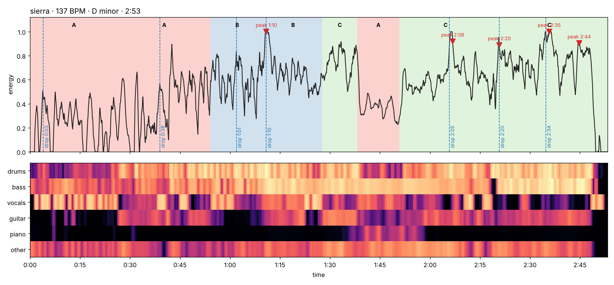

# Sound breakdown: sierra

**In one line:** edm at 137 BPM in D minor, triumphant, built from drums, low synth drone, full orchestra and electric guitar, with a spoken voiceover.

## Overview

| | | How sure |
|---|---|---|
| Length | 2:53 | measured |
| Tempo | 137 BPM | measured |
| Key | D minor (same notes as F major) | measured, medium |
| Tuning | A4 ≈ 439.9 Hz (-0 cents): standard concert tuning (A = 440 Hz) | measured, high agreement |
| Genre | edm (42%), video game soundtrack (13%), bollywood film song (12%) | model guess |
| Mood | triumphant (27%), dark and menacing (18%), tense and suspenseful (16%) | model guess |
| Production | wide cinematic orchestral sound (31%), loud, heavily compressed and punchy (30%) | model guess |
| Voice | spoken voice (narration / voiceover) | model guess |
| Main chord loop | F → Dm → B♭ → Gm (in 9% of the song) | measured, low |
| Most common chords | Dm, F, B♭, D5 | measured, medium |

## Instruments

Loudest first. Each one was separated from the mix, then identified by a music model and measured.

### Drums: Indian percussion or electronic drums
- **Identified as:** Indian percussion (41%), electronic drums (35%), hand percussion (10%) (not sure). Closest specific sounds: dhol (24%), boom bap hip hop drums (14%), dholak (9%)
- **Sound:** hard-hitting low end (big kick), balanced top end, plucky, percussive (short notes), busy, slightly wide, very dynamic (big loud/soft swings)
- **In the mix:** -5.7 dB vs the full song, playing 86% of the time, first comes in at 0:02
- **Frequency:** sub 39% · low 45% · mid 12% · high 4% (brightness ≈ 2804 Hz)

### Bass: synth / sub bass (low synth drone)
- **Identified as:** synth / sub bass (69%), acoustic low instruments (31%), bass guitar (0%) (confident). Closest specific sounds: low synth drone (56%), tuba or low brass (29%), deep sine sub bass (9%)
- **Sound:** deep sub-heavy (808-like), clean, pure tone, rhythmic with sustain, steady, mono / dead centre, very dynamic (big loud/soft swings)
- **In the mix:** -6.1 dB vs the full song, playing 93% of the time, first comes in at 0:00
- **Frequency:** sub 60% · low 39% · mid 0% · high 0% (brightness ≈ 177 Hz)
- **Notes:** range C♯1 – A♯1, most used D, B♭, F, G

### Vocals: spoken voice (narration / voiceover)
- **Sound:** balanced, clean, pure tone, plucky, percussive (short notes), steady, slightly wide, very dynamic (big loud/soft swings)
- **In the mix:** -10.2 dB vs the full song, playing 61% of the time, first comes in at 0:01
- **Frequency:** sub 1% · low 46% · mid 45% · high 8% (brightness ≈ 2532 Hz)

### Other: orchestral strings (full orchestra)
- **Identified as:** orchestral strings (58%), Indian melodic instruments (13%), keys (12%) (confident). Closest specific sounds: full orchestra (37%), santoor (11%), solo cello (10%)
- **Layers found over time:** full orchestra (1:10–1:20, 1:30–2:10, 2:20–2:50)
- **Sound:** warm, clean, pure tone, rhythmic with sustain, steady, very wide / spacious, very dynamic (big loud/soft swings)
- **In the mix:** -13.0 dB vs the full song, playing 95% of the time, first comes in at 0:00
- **Frequency:** sub 5% · low 21% · mid 72% · high 2% (brightness ≈ 1681 Hz)
- **Notes:** most used D, A, G, F

### Guitar: electric guitar (palm muted electric guitar)
- **Identified as:** electric guitar (71%), other plucked strings (19%), pizzicato strings (5%) (confident). Closest specific sounds: palm muted electric guitar (34%), slide guitar (22%), mandolin (9%)
- **Sound:** balanced, clean, pure tone, rhythmic with sustain, busy, wide stereo, very dynamic (big loud/soft swings)
- **In the mix:** -17.3 dB vs the full song, playing 73% of the time, first comes in at 0:06
- **Frequency:** sub 0% · low 30% · mid 67% · high 2% (brightness ≈ 1834 Hz)
- **Notes:** most used A, D, G, F
- **Guitar tuning (guess):** probably standard tuning (the few notes below low E look like bass bleeding into the guitar stem) (confidence low; lowest note ≈ A♯1)

Not in this song (only faint bleed): piano.

## Song map



| Time | Bars | Part | What it is | Energy | Playing | Chords |
|---|---|---|---|---|---|---|
| 0:00–0:26 | 15 | A | Intro | ██░░░░░░░░ | drums, bass, vocals, other | mostly A, A5, Bm (no steady loop) |
| 0:26–0:54 | 16 | A | Build-up | ████░░░░░░ | drums, bass, vocals, guitar, other | mostly B♭, F, Dm (no steady loop) |
| 0:54–1:10 | 9 | B | Verse / groove | ██████░░░░ | drums, bass, vocals, other | F → Dm → B♭ → Gm (loop) |
| 1:10–1:27 | 10 | B | Peak (chorus / drop) | ███████░░░ | drums, bass, vocals, guitar, other | mostly Dm, B♭, Bm (no steady loop) |
| 1:27–1:38 | 6 | C | Peak (chorus / drop) | ████████░░ | drums, bass, vocals, guitar, other | Bm → B♭ → F → Gm |
| 1:38–1:50 | 7 | A | Breakdown / quiet part | ████░░░░░░ | drums, bass, vocals, guitar, other | mostly D5, Dm, F (no steady loop) |
| 1:50–2:18 | 16 | C | Verse / groove | ██████░░░░ | drums, bass, vocals, guitar, other | mostly Dm, D5, G (no steady loop) |
| 2:18–2:53 | 20 | C | Peak (chorus / drop) | ███████░░░ | drums, bass, guitar, other | mostly F, B♭, Dm (no steady loop) |

Parts with the same letter sound alike. Chords are per bar; treat them as a guide.

## Key moments

- **0:03** big hit / drop
- **0:38** big hit / drop
- **1:10** big hit / drop: guitar comes in
- **1:38** pull-back: drums and guitar drop out
- **2:05** big hit / drop
- **2:20** big hit / drop: bass comes in
- **2:38** pull-back
- **2:48** pull-back: drums, bass, guitar and other drop out

## The beat

One bar of 4/4 in 16th notes (X = strong hit, x = softer hit, . = nothing), averaged over the song:

```
                 1... 2... 3... 4...
Kick             XXXx xxxx x.xx Xxx.   ~14 hits/bar, in 95% of bars
Snare/Clap       X... x... X... X.x.   ~5 hits/bar, in 69% of bars
Hi-hats/Cymbals  X..x Xxx. X... X.X.   ~8 hits/bar, in 73% of bars
```

The drum sound wasn't clearly identified, so this pattern may include non-drum hits.

## Mix and production

- **Overall:** moderate loudness with room to breathe, some loud/soft contrast, balanced tone, moderately wide
- **Loudness:** loud parts at -15.4 dBFS, peaks at -2.3 dBFS; 6.2 dB between loud and quiet parts
- **Tonal balance:** sub (<60 Hz) 35% · bass (60–250) 39% · mids (250–4k) 23% · highs (>4k) 3%
- **Stereo width:** 0.3 (0 = mono, 1 = extremely wide)

## Sound design (non-music sounds)

Environmental noise (0:00); Bird (0:00); Outside, rural or natural (0:00); Bird vocalization, bird call, bird song (0:00); Animal (0:00); Chirp, tweet (0:00); Vehicle (0:10, 0:40, 1:50); Rain (0:20); Pink noise (0:20); Rain on surface (0:20); Horse (0:30); Clip-clop (0:30); Boom (1:10, 2:10); Water (1:40); Water tap, faucet (1:40); Ocean (2:20); Waves, surf (2:20); Boat, Water vehicle (2:40); Train (2:40); Single-lens reflex camera (2:50)

## Prompts to recreate this

**Suno, Simple mode** (paste into the one box):

```
Edm at 137 BPM in D minor, triumphant, dark and menacing, starting with drums, low synth drone and full orchestra, then building with electric guitar, into a powerful peak around 1:27, dropping into a quieter breakdown before rising again, fully instrumental with no vocals
```

**Suno, Advanced mode, Styles box:**

```
edm, 137 BPM, D minor, triumphant, dark and menacing, drums, low synth drone, full orchestra, electric guitar, wide cinematic orchestral sound, instrumental
```

**Lyrics box:** leave empty (this track has no singing).

---
Stems: Demucs htdemucs_6s. Instrument, genre and mood names: LAION CLAP. Voice and sound effects: MIT AST. Tempo, key, tuning, chords, energy and timbre: measured with librosa. Stems are in `stems/`.